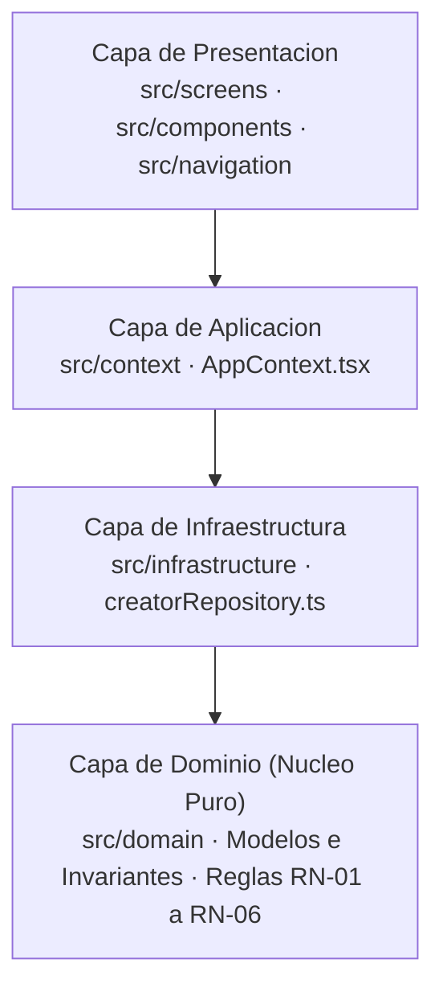
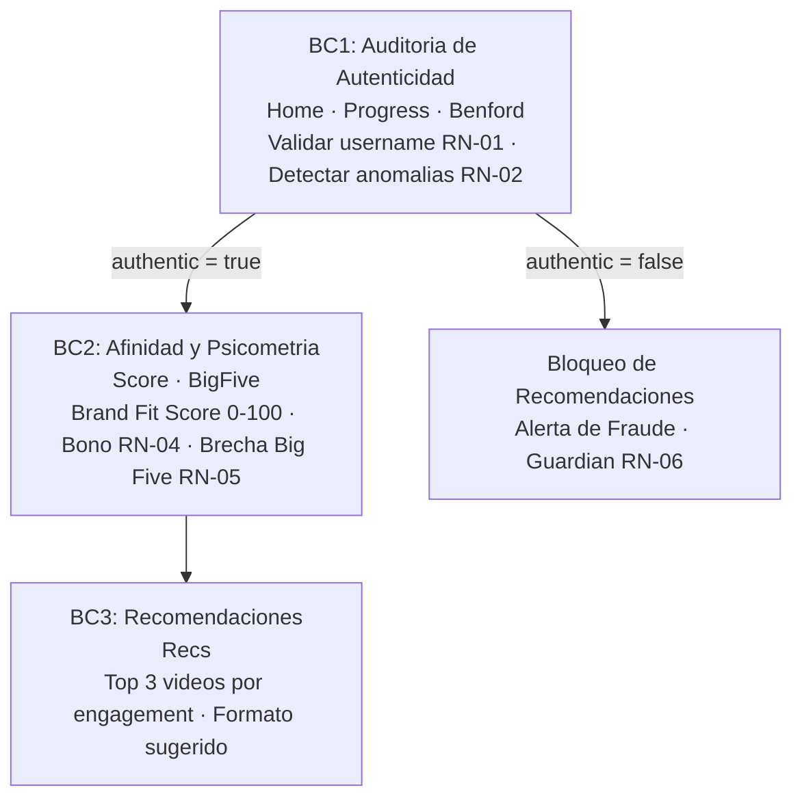

# Arquitectura de Software y Metodologia DDD — BrandFit Mobile

> React Native + Expo + TypeScript. Arquitectura en Capas con Inversion de Dependencias.

---

## 1. Patron Arquitectonico vs. Metodologia de Diseno

| Concepto | Tipo | Descripcion |
|---|---|---|
| **Arquitectura en Capas (Layered / Clean Architecture)** | Patron de Arquitectura de Software | Define la organizacion y comunicacion de los modulos del sistema. Establece fronteras, flujo de dependencias e independencia del dominio. |
| **Domain-Driven Design (DDD)** | Metodologia de Diseno | Enfoque centrado en el negocio para comprender el problema, delimitar subdominios (Bounded Contexts), unificar el vocabulario (Lenguaje Ubicuo) e implementar modelos tacticos. |

---

## 2. Arquitectura en Capas

### Principios de la Arquitectura

| Principio | Implementacion |
|---|---|
| **Inversion de Dependencias** | El flujo de dependencias apunta siempre hacia el nucleo (dominio). Ninguna capa interna importa capas externas. |
| **Dominio independiente** | `src/domain/` es 100% TypeScript puro; no importa React Native, Expo ni ninguna libreria de UI. |
| **Infraestructura como adaptador** | `creatorRepository.ts` implementa la consulta de datos en memoria con el mismo contrato que consumira el scraper real. |
| **Presentacion desacoplada** | Pantallas y componentes consumen solo servicios de dominio y estado de aplicacion, sin logica de negocio embebida. |

### Responsabilidades por Capa

| Capa | Ubicacion | Responsabilidad |
|---|---|---|
| **Presentacion** | `src/screens`, `src/components`, `src/navigation` | Renderizado de interfaces organizadas por Bounded Context. Atomic Design. |
| **Aplicacion** | `src/context/AppContext.tsx` | Orquestacion de casos de uso: `startAnalysis`, `finishAnalysis`, `setArchetype` |
| **Infraestructura** | `src/infrastructure/repositories/creatorRepository.ts` | `resolveAuditedCreator(username)` — resolucion de la entidad auditada en memoria |
| **Dominio** | `src/domain/` | Modelos de negocio, invariantes y reglas puras RN-01 a RN-06 |

---

## 3. Metodologia DDD: Bounded Contexts

| Bounded Context | Responsabilidad del Negocio | Pantallas |
|---|---|---|
| **BC1** Auditoria de Autenticidad | Validar `@username`, auditar 10 videos, dictaminar autenticidad matematica | Home → Progress → Benford |
| **BC2** Afinidad y Psicometria | Calcular Brand Fit Score (0-100), bono de engagement, brecha psicometrica Big Five | Score → BigFive |
| **BC3** Recomendaciones de Contenido | Top 3 videos por engagement, tono editorial y formato sugerido tactico | Recs |

---

## 4. Lenguaje Ubicuo (Ubiquitous Language)

| Termino de Negocio | En el Codigo | Definicion |
|---|---|---|
| Creador Auditado | `Creator` *(Aggregate Root)* | Entidad principal que encapsula identidad, metricas, rasgos psicologicos y evaluaciones del influencer |
| Arquetipo de Marca | `Archetype` / `ArchetypeId` | Perfil de identidad corporativa: `tech`, `bienestar`, `entretenimiento`, `finanzas`, `causas` |
| Distribucion de Benford | `BENFORD_EXPECTED` / `benfordObserved` | Frecuencia teorica vs. real de primeros digitos en contadores de interaccion |
| Veredicto de Autenticidad | `authentic: boolean`, `confidence: number` | Determinacion binaria de legitimidad de la cuenta y porcentaje de certidumbre estadistica |
| Brand Fit Score | `scores: Record<ArchetypeId, number>` | Puntuacion de compatibilidad normalizada 0-100 |
| Perfil Psicometrico Big Five | `TRAITS` / `bigFive: number[]` | Vector OCEAN: Apertura, Responsabilidad, Extraversion, Amabilidad, Neuroticismo |
| Vector Ideal del Arquetipo | `IDEALS: Record<ArchetypeId, number[]>` | Puntuaciones psicometricas de referencia por arquetipo corporativo |
| Brecha Psicometrica | `evaluateTraitAlignment()` | Distancia absoluta creador vs. ideal; activa barra ambar si excede tolerancia |
| Bono de Traccion | `engagementBonus()` | Puntos adicionales al score segun la tasa organica de interaccion |
| Tono Editorial | `Tone` | Clasificacion afectiva del contenido: `positivo`, `neutro`, `negativo` |
| Video Destacado | `Video` *(Value Object)* | Titulo, vistas formateadas, engagement rate y tono de un video de la muestra |
| Formato Sugerido | `format: string` | Recomendacion tactica de formato de contenido para maximizar el impacto de la campana |

---

## 5. Reglas de Negocio — Domain Services

Implementadas como funciones TypeScript puras en `src/domain/services/rules.ts`. Sin efectos secundarios. Sin importaciones de React Native.

| Regla | Funcion | Entrada | Comportamiento |
|---|---|---|---|
| **RN-01** | `validateCreatorUsername(rawInput)` | `string` | Sanitiza `@` y espacios. Valida `/^[a-zA-Z0-9._]{2,24}$/`. Retorna `{valid, clean, error?}` |
| **RN-02** | `hasSuspiciousPattern(username)` | `string` | Evalua si el handle coincide con `SUSPICIOUS_HINTS` (bots, granjas infladas). Retorna `boolean` |
| **RN-03a** | `scoreTone(score)` | `number` | `>= 65` → `'success'` · `>= 45` → `'warning'` · `< 45` → `'danger'` |
| **RN-03b** | `affinityVerdictLabel(score)` | `number` | `>= 70` → `"Excelente afinidad"` · `< 70` → `"Buena afinidad"` |
| **RN-04** | `engagementBonus(engagement)` | `number` | `>= 7%` → +5 pts · `>= 5%` → +3 pts · `>= 3%` → +1 pt · `< 3%` → 0 |
| **RN-05** | `evaluateTraitAlignment(val, target)` | `number, number` | Si `|target - val| <= 15` → alineado (verde). Si `> 15` → desalineado (ambar) |
| **RN-06** | `canShowRecommendations(authentic)` | `boolean` | Si `authentic === false` bloquea `RecsScreen` para proteger el presupuesto de la marca |
