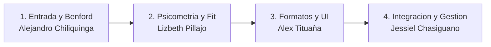
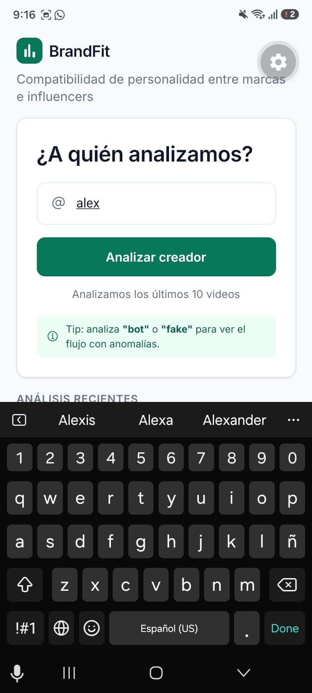
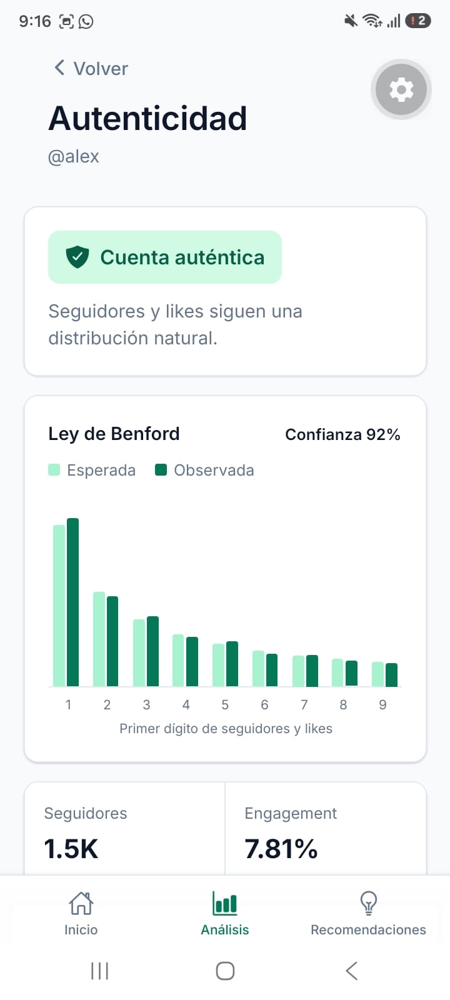

# BrandFit · Prototipo Movil

<p align="center">
  <strong>Prototipo interactivo de interfaz movil para la evaluacion, auditoria de autenticidad y colaboracion estrategica entre marcas y creadores de contenido.</strong>
</p>

<p align="center">
  <a href="https://expo.dev"></a>
  <a href="https://reactnative.dev"></a>
  <a href="https://www.typescriptlang.org"></a>
  <a href="https://deepmind.google/technologies/gemini/"></a>
  <a href="LICENSE"></a>
</p>

---

## Alcance del Repositorio

> [!NOTE]
> Este repositorio contiene exclusivamente el **prototipo frontend de la aplicacion movil**, desarrollado en **React Native con Expo SDK 58**. Opera con datos simulados (mock data) tipados en memoria para representar el flujo de usuario y la experiencia de navegacion sin conexion a scraper ni servicios de backend.

---

## 1. Planteamiento del Problema

### El Problema
En el marketing de influencers B2B, las decisiones de contratacion se fundamentan frecuentemente en metricas superficiales (seguidores y likes) vulnerables a manipulacion artificial mediante bots. Esto genera inversiones fallidas, falta de engagement organico real y riesgos reputacionales por desalineacion entre los valores del creador y el arquetipo de la marca.

**BrandFit** transforma este proceso en una decision guiada por datos objetivos: valida la autenticidad matematica de la audiencia, mide el ajuste psicologico entre creador y marca, y recomienda los formatos de contenido de mayor traccion.

### Origen de la Informacion
Los datos analizados corresponden a la huella digital publica de creadores en TikTok:
* Identificador `@username`, nombre visible y total de seguidores.
* Muestra de los ultimos 10 videos (vistas, likes, comentarios y tasa de engagement organico).
* Frecuencia de distribucion de primeros digitos para analisis forense mediante la **Ley de Benford**.
* Tonalidad editorial y categorizacion de formatos de video.

En este prototipo, los datos son provistos por repositorios en memoria (`src/infrastructure/repositories/creatorRepository.ts`) que replican el contrato del scraper definitivo.

---

## 2. Equipo y Asignacion de Tareas

El desarrollo se ejecuto en un pipeline colaborativo y secuencial de cuatro etapas:



| Integrante | Rol y Rama | Fase | Responsabilidad y Aportes Clave |
|---|---|---|---|
| **Alejandro Chiliquinga** | UX & Deteccion de Fraude<br>`feat/alejo-ux-screens` | Fase 1 | Entrada de usuario y soporte de teclado en `HomeScreen`, paso de metricas por la Ley de Benford, generacion de alertas rojas de fraude en `BenfordScreen` y palabras clave `SUSPICIOUS_HINTS`. |
| **Lizbeth Pillajo** | Arquitectura & Dominio<br>`feat/prototipo-liz` | Fase 2 | Evaluacion de engagement en 10 videos, modelado psicometrico Big Five (OCEAN), cruce con arquetipos de marca, calculo del Brand Fit Score, estructuracion de capas y reglas puras RN-01 a RN-06. |
| **Alex Tituaña** | Diseno UI & Recomendaciones<br>`feat/alex-ui-components` | Fase 3 | Aislamiento de videos de mayor acogida organica, recomendacion de formatos estrategicos en `RecsScreen`, creacion de la libreria de componentes nativos (Atomic Design) y accesibilidad tactil. |
| **Jessiel Chasiguano** | Project Manager & Integrador<br>`main` | Fase 4 | Coordinacion general, revision y fusion de Pull Requests (#1 al #8), resolucion de conflictos, integracion de modulos, estabilizacion tecnica de dependencias/rutas y documentacion. |

---

## 3. Arquitectura y Metodologia

La aplicacion implementa un patron de **Arquitectura en Capas (Layered / Clean Architecture)** con inversion de dependencias, desacoplando el Dominio puro (0% dependencias de UI) de la Infraestructura, Aplicacion y Presentacion. El modelado conceptual del negocio se rige bajo la metodologia **Domain-Driven Design (DDD)** a traves de Bounded Contexts y Reglas de Negocio formales (**RN-01 a RN-06**).

> Para consultar el diagrama de capas, la especificacion del Lenguaje Ubicuo, Aggregate Roots y las Reglas de Negocio en detalle, consulta [ARCHITECTURE.md](ARCHITECTURE.md).

---

## 4. Demostracion Visual

Flujo de pantallas interactivas ejecutadas en **Expo Go**:

| 1. Inicio y Busqueda | 2. Progreso de Analisis | 3. Autenticidad (Benford) | 4. Alerta de Anomalias |
| :---: | :---: | :---: | :---: |
|  |  |  |  |

| 5. Brand Fit Score | 6. Selector de Arquetipos | 7. Desglose Big Five | 8. Recomendaciones |
| :---: | :---: | :---: | :---: |
|  |  |  |  |

* **Prototipo Figma:** [Figma Design](https://www.figma.com/design/QDYvI7DBZFhUtxmk8o9UB5/Prototipo-BradFit-Grupal?node-id=1-3&t=9IAFZa4ba9yWmyDh-1)
* **Sistema de Diseno (Atomic Design):** [FigJam Board](https://www.figma.com/board/Zk2FYhOvrQX7BCrwJppllL/BrandFit-%C2%B7-Atomic-Design?node-id=0-1&p=f&t=rE8uW77jN4BucfBq-0)

---

## 5. Estructura del Repositorio

```text
BrandFit/
├── assets/                              Recursos graficos e iconos
├── docs/                                Capturas y documentacion visual
├── src/
│   ├── components/                      Componentes nativos reutilizables (Atomic Design)
│   ├── context/                         Capa de Aplicacion: orquestador de estado (AppContext.tsx)
│   ├── data/                            Re-exports para retrocompatibilidad
│   ├── domain/                          Capa de Dominio: tipos, constantes y reglas puras RN-01..06
│   ├── infrastructure/                  Capa de Infraestructura: repositorios en memoria
│   ├── navigation/                      Enrutador y proteccion de notch (AppNavigator.tsx)
│   ├── screens/                         Capa de Presentacion: pantallas por Bounded Context
│   └── theme/                           Tokens de diseno: colores, espaciados y tipografia
├── ARCHITECTURE.md                      Especificacion tecnica de arquitectura y DDD
├── app.json                             Configuracion de Expo SDK 58
├── package.json                         Dependencias y scripts del proyecto
└── README.md                            Documentacion general
```

---

## 6. Instrucciones de Ejecucion

**Requisitos:** Node.js 18+ y la aplicacion **Expo Go** en tu dispositivo movil ([Google Play](https://play.google.com/store/apps/details?id=host.exp.exponent) o [App Store](https://apps.apple.com/app/expo-go/id982107779)).

```bash
# 1. Clonar el repositorio
git clone https://github.com/JessielCH/BrandFit_Grupo9.git
cd BrandFit

# 2. Instalar dependencias
npm install --legacy-peer-deps

# 3. Iniciar el servidor de desarrollo
npx expo start -c
```

* **Android:** Escanear el codigo QR desde la aplicacion Expo Go.
* **iOS:** Escanear el codigo QR con la camara nativa y abrir en Expo Go.
* **Navegador Web:** Presionar `w` en la terminal.

> [!TIP]
> Para probar la deteccion de fraude en vivo, escribe `@viralboost`, `@bot` o `@fake` en el buscador de la pantalla de inicio.

---

## Licencia

Distribuido bajo la licencia [MIT](LICENSE).
