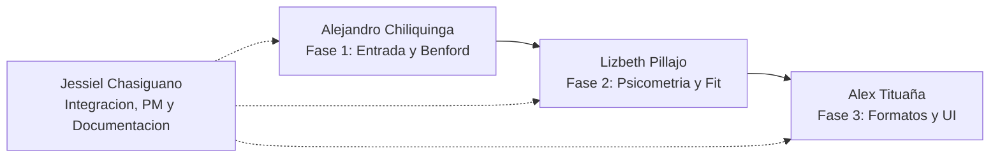
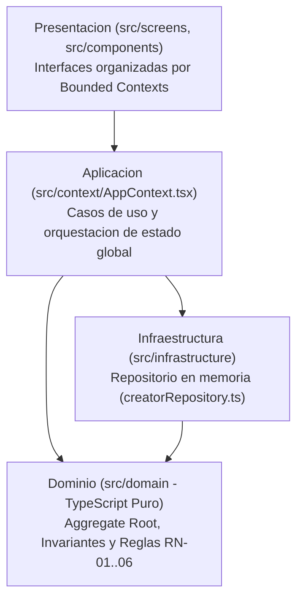
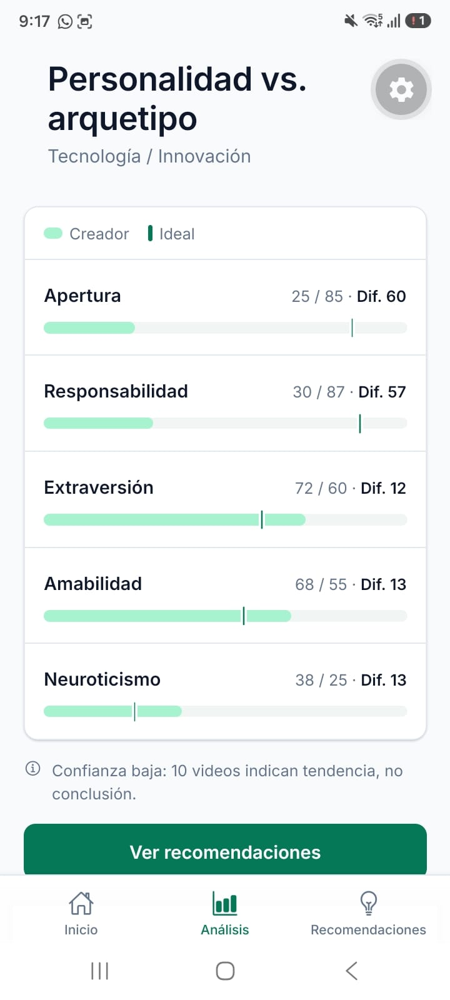

# BrandFit · Prototipo Movil

<p align="center">
  <strong>Prototipo interactivo de interfaz movil para la evaluacion, auditoria de autenticidad y colaboracion estrategica entre marcas y creadores de contenido.</strong>
</p>

<p align="center">
  <a href="https://expo.dev"></a>
  <a href="https://reactnative.dev"></a>
  <a href="https://www.typescriptlang.org"></a>
  <a href="https://deepmind.google/technologies/gemini/"></a>
  <a href="LICENSE"></a>
</p>

---

## Alcance del Repositorio

> [!NOTE]
> Este repositorio contiene exclusivamente el **prototipo frontend de la aplicacion movil**, desarrollado en **React Native con Expo SDK 58**. Implementa un patron de **Arquitectura en Capas (Layered / Clean Architecture)** y un modelado conceptual basado en la **metodologia Domain-Driven Design (DDD)**. Opera con datos simulados (mock data) tipados en memoria para validar la experiencia de usuario y las reglas de negocio antes de la integracion con servicios de backend y scraping.

---

## 1. Planteamiento del Problema y Adaptabilidad Visual

### Problema y Origen de Datos

En el marketing de influencers B2B, las decisiones de contratacion suelen basarse en metricas de vanidad facilmente manipulables (compra de seguidores o likes), generando inversiones fallidas y desalineacion de valores entre marca y creador. 

**BrandFit** audita la autenticidad y compatibilidad mediante datos publicos extraidos de perfiles de TikTok:
* Identificador `@username`, conteo de seguidores y metricas de interaccion.
* Muestra de los ultimos 10 videos (vistas, likes, comentarios, engagement rate).
* Distribucion de primeros digitos en interacciones para analisis forense mediante la **Ley de Benford**.
* Analisis de tono de contenido y clasificacion de formatos de video.

### Adaptacion a Relaciones de Aspecto (9:16, 16:9 y 1:1)

La interfaz se diseno contemplando resolucion, densidad de pixeles (DPI/PPI) y relaciones de aspecto en dispositivos moviles:

| Relacion | Contexto de Uso | Consideraciones Tecnicas y Adaptabilidad |
|---|---|---|
| **9:16** (Vertical Movil) | Vistas principales de navegacion y miniaturas estilo Reel/TikTok | Formato nativo de smartphones modernos. Se implementa con `SafeAreaView` (`react-native-safe-area-context`) para aislar notches y Dynamic Island, junto con `ScrollView` elásticos y `KeyboardAvoidingView` para evitar desbordes. |
| **16:9** (Panoramico) | Modulo de auditoria de Benford (`BenfordScreen`) | Proporcion apaisada en tarjetas metricas que permite desplegar los 9 digitos observados vs. la curva teorica sin congestion visual horizontal. |
| **1:1** (Cuadrangular) | Avatares de creadores y velocimetro de Brand Fit Score | Componentes con geometria simetrica (`Avatar.tsx`). El velocimetro radial en `ScoreScreen.tsx` utiliza vectores SVG escalables (`react-native-svg`, `viewBox="0 0 200 200"`), garantizando nitidez independiente de la densidad de pantalla. |

---

## 2. Equipo y Asignacion de Tareas

El desarrollo se organizo en tres fases funcionales continuas, respaldadas por una etapa transversal de integracion y arquitectura:



| Integrante | Rol y Rama | Fase | Aportes Clave y Responsabilidad |
|---|---|---|---|
| **Alejandro Chiliquinga** | UX & Deteccion de Fraude<br>`feat/alejo-ux-screens` | Fase 1 | Entrada de usuario, envio por teclado en `HomeScreen`, scraping conceptual de seguidores/likes, verificacion mediante Ley de Benford, alertas rojas de fraude y ampliacion de `SUSPICIOUS_HINTS`. |
| **Lizbeth Pillajo** | Arquitectura & Dominio<br>`feat/prototipo-liz` | Fase 2 | Evaluacion de engagement de los 10 videos, modelado psicometrico Big Five (OCEAN), cruce con arquetipos de marca, calculo de Brand Fit Score, estructuracion de capas DDD y reglas puras RN-01 a RN-06. |
| **Alex Tituaña** | Diseno UI & Recomendaciones<br>`feat/alex-ui-components` | Fase 3 | Aislamiento de videos con mayor acogida real, recomendacion de formatos estrategicos en `RecsScreen`, construccion de componentes nativos reutilizables (Atomic Design) y estandarizacion de accesibilidad (`hitSlop`, sombras). |
| **Jessiel Chasiguano** | Project Manager & Integrador<br>`main` | Transversal | Coordinacion del equipo, resolucion de conflictos de fusion, revision y merge de todos los Pull Requests (#1 al #8), estabilizacion tecnica de dependencias/rutas y elaboracion de la documentacion tecnica. |

---

## 3. Arquitectura de Software y Metodologia

Se establece una estricta distincion entre el patron arquitectonico y el metodo de modelado:



* **Patron Arquitectonico — Arquitectura en Capas (Layered / Clean Architecture):** Separacion estricta de responsabilidades con inversion de dependencias. El dominio (`src/domain/`) es 100% TypeScript puro y desconoce React Native o APIs externas. La infraestructura implementa adaptadores de persistencia sin acoplar la logica de negocio.
* **Metodologia de Modelado — Domain-Driven Design (DDD):** Enfoque guiado por el negocio para delimitar subdominios mediante Bounded Contexts y formalizar el Lenguaje Ubicuo.

### Bounded Contexts y Reglas de Negocio

| Bounded Context | Pantallas | Reglas de Negocio Implementadas (`src/domain/services/rules.ts`) |
|---|---|---|
| **BC1: Auditoria y Fraude** | `HomeScreen`<br>`ProgressScreen`<br>`BenfordScreen` | **RN-01:** Validacion y sanitizacion de handle (`/^[a-zA-Z0-9._]{2,24}$/`).<br>**RN-02:** Deteccion de patrones anómalos o bots (`SUSPICIOUS_HINTS`). |
| **BC2: Afinidad y Psicometria** | `ScoreScreen`<br>`BigFiveScreen` | **RN-03a/b:** Semaforo y etiqueta de afinidad del Brand Fit Score.<br>**RN-04:** Bono de traccion segun engagement rate (+1 a +5 pts).<br>**RN-05:** Evaluacion de brecha psicometrica Big Five vs. ideal del arquetipo (tolerancia $\le 15$). |
| **BC3: Recomendaciones** | `RecsScreen` | **RN-06:** Guardian de recomendaciones; bloquea sugerencias si la cuenta es fraudulenta (`authentic === false`). |

> Para consultar la definicion completa del Lenguaje Ubicuo, Aggregate Roots y contratos de dominio, ver [ARCHITECTURE.md](ARCHITECTURE.md).

---

## 4. Demostracion Visual y Flujo

El flujo interactivo se compone de 6 pantallas principales ejecutadas en **Expo Go**:

| 1. Inicio y Busqueda | 2. Progreso de Analisis | 3. Autenticidad (Benford) | 4. Alerta de Anomalias |
| :---: | :---: | :---: | :---: |
|  |  |  |  |

| 5. Brand Fit Score | 6. Selector de Arquetipos | 7. Desglose Big Five | 8. Recomendaciones |
| :---: | :---: | :---: | :---: |
|  |  |  |  |

* **Prototipo Figma:** [Figma Design](https://www.figma.com/design/QDYvI7DBZFhUtxmk8o9UB5/Prototipo-BradFit-Grupal?node-id=1-3&t=9IAFZa4ba9yWmyDh-1)
* **Sistema de Diseno (Atomic Design):** [FigJam Board](https://www.figma.com/board/Zk2FYhOvrQX7BCrwJppllL/BrandFit-%C2%B7-Atomic-Design?node-id=0-1&p=f&t=rE8uW77jN4BucfBq-0)

---

## 5. Estructura del Repositorio

```text
BrandFit/
├── assets/                              Recursos graficos e iconos
├── docs/                                Capturas y documentacion visual
├── src/
│   ├── components/                      Libreria de componentes nativos (Atomic Design)
│   ├── context/                         Capa de Aplicacion: orquestador de estado (AppContext.tsx)
│   ├── data/                            Re-exports para retrocompatibilidad
│   ├── domain/                          Capa de Dominio (TypeScript puro, modelos y reglas RN-01..06)
│   ├── infrastructure/                  Capa de Infraestructura (repositorios en memoria)
│   ├── navigation/                      Enrutador y proteccion de notch (AppNavigator.tsx)
│   ├── screens/                         Capa de Presentacion (vistas por Bounded Context)
│   └── theme/                           Tokens de diseno: colores, espaciados y tipografia
├── ARCHITECTURE.md                      Especificacion tecnica de la arquitectura en capas y DDD
├── app.json                             Configuracion de Expo SDK 58
├── package.json                         Dependencias y scripts
└── README.md                            Documentacion general del proyecto
```

---

## 6. Instrucciones de Ejecucion

**Requisitos:** Node.js 18+ y la app **Expo Go** instalada en tu dispositivo movil ([Google Play](https://play.google.com/store/apps/details?id=host.exp.exponent) o [App Store](https://apps.apple.com/app/expo-go/id982107779)).

```bash
# 1. Clonar el repositorio
git clone https://github.com/JessielCH/BrandFit_Grupo9.git
cd BrandFit

# 2. Instalar dependencias
npm install --legacy-peer-deps

# 3. Iniciar el servidor de desarrollo
npx expo start -c
```

* **Android:** Escanear el codigo QR desde la aplicacion Expo Go.
* **iOS:** Escanear el codigo QR con la camara nativa y abrir en Expo Go.
* **Navegador Web:** Presionar `w` en la terminal.

> [!TIP]
> Para probar la deteccion de fraude en vivo, escribe `@viralboost`, `@bot` o `@fake` en el buscador de la pantalla de inicio.

---

## Licencia

Distribuido bajo la licencia [MIT](LICENSE).
