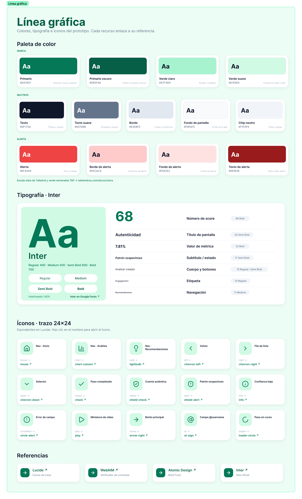
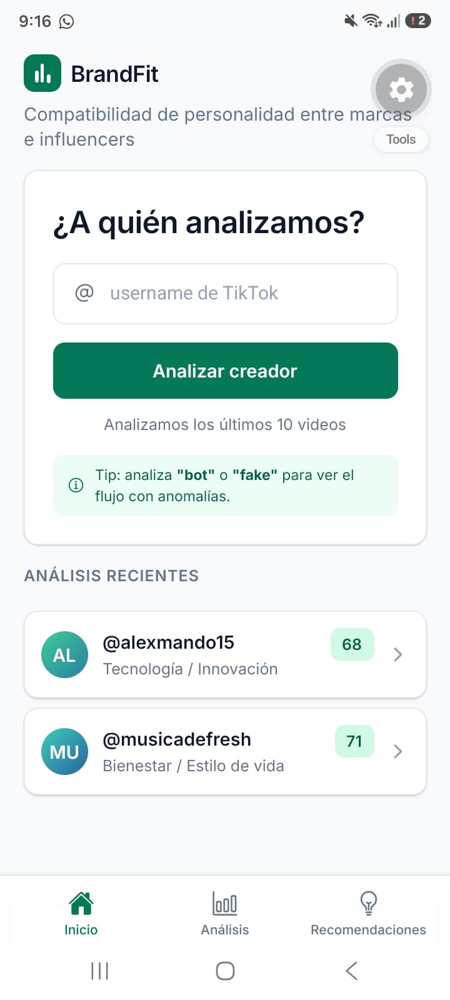
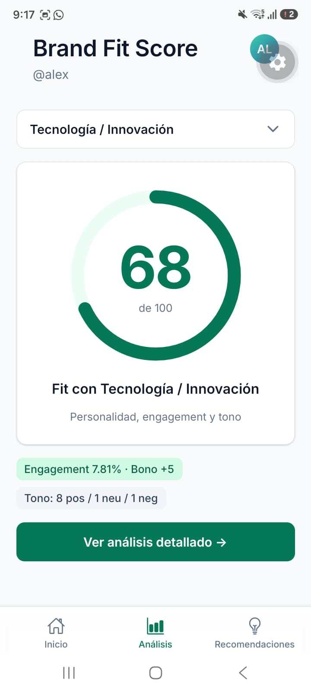

# BrandFit · Prototipo Móvil

<p align="center">
  <strong>Prototipo interactivo de interfaz móvil para la evaluación y colaboración estratégica entre marcas y creadores de contenido.</strong>
</p>

<p align="center">
  <a href="https://expo.dev"></a>
  <a href="https://reactnative.dev"></a>
  <a href="https://www.typescriptlang.org"></a>
  <a href="https://deepmind.google/technologies/gemini/"></a>
  <a href="LICENSE"></a>
</p>

---

## Alcance del Repositorio

> [!NOTE]
> Este repositorio corresponde exclusivamente al **prototipo frontend de la aplicación móvil**.
> 
> La aplicación fue construida traduciendo el diseño de **Figma a código ejecutable en React Native con Expo y Expo Go**, apoyándose en herramientas de inteligencia artificial. La interfaz utiliza **datos simulados (mock data)** para representar visualmente la navegación, pantallas y componentes del flujo de usuario, sin incluir aún la implementación del scraper o los servicios de backend.

---

## Integrantes

* **Jessiel Chasiguano**
* **Alejandro Chiliquinga**
* **Liz Pillajo**
* **Alex Tituaña**

---

## Enlaces del Diseño (Figma)

El prototipo móvil y su sistema de diseño visual fueron desarrollados en Figma y FigJam:

| Recurso | Herramienta | Enlace |
| :--- | :--- | :--- |
| **Prototipo de Interfaz Móvil** | Figma Design | [](https://www.figma.com/design/QDYvI7DBZFhUtxmk8o9UB5/Prototipo-BradFit-Grupal?node-id=1-3&t=9IAFZa4ba9yWmyDh-1) |
| **Sistema de Atomic Design** | FigJam | [](https://www.figma.com/board/Zk2FYhOvrQX7BCrwJppllL/BrandFit-%C2%B7-Atomic-Design?node-id=0-1&p=f&t=rE8uW77jN4BucfBq-0) |

---

## ¿Por Qué Elegimos Esta Idea de Negocio?

El marketing de influencers se ha consolidado como un canal publicitario indispensable para las empresas, moviendo miles de millones de dólares anualmente. Sin embargo, adolece de un **problema crítico de ineficiencia y riesgo financiero**: la gran mayoría de marcas toman decisiones basadas únicamente en métricas de vanidad (número de seguidores y likes superficiales) que son sumamente vulnerables a la manipulación mediante granjas de bots y cuentas infladas artificialmente. A esto se suma el riesgo reputacional cuando los valores reales del creador chocan con la identidad corporativa de la marca.

Elegimos **BrandFit** porque ataca directamente ese dolor del mercado en el segmento B2B. Nuestro propósito es transformar la contratación de influencers de una apuesta intuitiva y azarosa a una **decisión corporativa guiada por datos analíticos**: permitiendo a las empresas auditar la autenticidad real de la audiencia antes de invertir un centavo, garantizar que la personalidad del creador armonice con el arquetipo de la marca, y saber con exactitud qué formatos de contenido generarán el mayor retorno en la audiencia real.

---

## Concepción de la Idea y Toma de Decisiones

### Definición del Modelo de Negocio

Durante las sesiones iniciales de ideación, el equipo presentó dos enfoques distintos:

* **Enfoque B2B:** Orientado hacia las marcas que buscan identificar, auditar y seleccionar creadores fiables con los cuales colaborar.
* **Enfoque B2C:** Orientado hacia los creadores de contenido para ayudarlos a analizar y potenciar el alcance de sus publicaciones.

Con la asistencia analítica de **Gemini 3.8**, se evaluó que ambas visiones podían integrarse de forma complementaria dentro de un único flujo enfocado en el modelo B2B, permitiendo que la marca obtenga valor en tres etapas continuas:

1. **Filtro inicial de autenticidad:** La marca ingresa el usuario; el flujo conceptual contempla validar las métricas de interacción para detectar si la cuenta presenta anomalías o patrones artificiales antes de avanzar.
2. **Evaluación de compatibilidad de marca:** Análisis del engagement sobre una muestra de videos recientes, contrastando los rasgos de personalidad del creador con el arquetipo de la marca para determinar el nivel de afinidad.
3. **Recomendación estratégica de formatos:** Identificación de los videos de mayor rendimiento orgánico para sugerir a la marca formatos de contenido específicos que su audiencia real consume con mayor frecuencia.

La estructura de pantallas y componentes visuales se construyó tomando como referencia la metodología de **Atomic Design** diseñada en FigJam, facilitando la modularización y coherencia visual en cada vista.

<p align="center">
  
</p>

---

## Demostración Visual del Prototipo

Capturas reales del flujo de navegación y pantallas interactivas ejecutadas en **Expo Go**:

| 1. Inicio y Búsqueda | 2. Progreso de Análisis | 3. Autenticidad (Benford) | 4. Alerta de Anomalías |
| :---: | :---: | :---: | :---: |
|  |  |  |  |

| 5. Brand Fit Score | 6. Selector de Arquetipos | 7. Desglose Big Five | 8. Recomendaciones |
| :---: | :---: | :---: | :---: |
|  |  |  |  |

---

## Uso de Inteligencia Artificial en el Desarrollo

Para el desarrollo de este prototipo se utilizaron **Gemini 3.8** y el entorno de desarrollo **Antigravity IDE**:

* **Articulación de la idea:** Gemini colaboró en el análisis de las propuestas del equipo, unificando el modelo de negocio y definiendo el recorrido de usuario.
* **Traducción de Figma a React Native:** Asistencia para transformar las pantallas y componentes definidos en Figma a componentes nativos en React Native, manteniendo la fidelidad visual, tipografía Inter y espaciados del diseño original.
* **Configuración del entorno móvil con Expo:** Soporte para la configuración del proyecto en **Expo SDK 58**, compatibilidad de dependencias de React 19 y preparación para su ejecución directa en **Expo Go**.

---

## Estructura del Repositorio

El código fuente se encuentra organizado directamente en la raíz del repositorio:

```text
BrandFit/
├── assets/          # Recursos gráficos e iconos de la aplicación
├── docs/            # Documentación visual, diagramas de diseño y capturas
│   ├── design/      # Esquemas de arquitectura Atomic Design
│   └── screenshots/ # Capturas del prototipo en ejecución
├── src/
│   ├── components/  # Componentes reutilizables (Atomic Design)
│   ├── context/     # Contexto global de navegación y estado de la app
│   ├── data/        # Datos simulados (mock data) y definiciones de tipos
│   ├── navigation/  # Enrutador de pantallas
│   ├── screens/     # Pantallas del prototipo (Inicio, Progreso, Métricas, Fit, Recomendaciones)
│   └── theme/       # Tokens de color, espaciados y tipografía
├── app.json         # Configuración del proyecto Expo
├── babel.config.js  # Configuración del compilador Babel
├── index.ts         # Punto de entrada de la aplicación
├── package.json     # Manifiesto de dependencias
├── tsconfig.json    # Configuración de TypeScript
└── README.md        # Documentación general
```

---

## Instrucciones de Ejecución

### Requisitos previos

* **Node.js** (versión 18 o superior).
* La aplicación móvil **Expo Go** instalada en tu teléfono ([Google Play Store](https://play.google.com/store/apps/details?id=host.exp.exponent) o [Apple App Store](https://apps.apple.com/app/expo-go/id982107779)), o un emulador local.

### Pasos para ejecutar

1. **Navegar a la carpeta del proyecto:**
   ```powershell
   cd BrandFit
   ```

2. **Instalar dependencias:**
   ```powershell
   npm install --legacy-peer-deps
   ```

3. **Iniciar el servidor de desarrollo:**
   ```powershell
   npx expo start -c
   ```

4. **Abrir la aplicación:**
   * **En Android:** Abre la app **Expo Go** y escanea el código QR mostrado en la terminal.
   * **En iOS:** Abre la cámara de tu iPhone, enfoca el código QR y pulsa la notificación para abrirlo en **Expo Go**.
   * **En Navegador Web:** Presiona la tecla **`w`** en la terminal.

---

## Licencia

Este proyecto está bajo la licencia [MIT](LICENSE).
