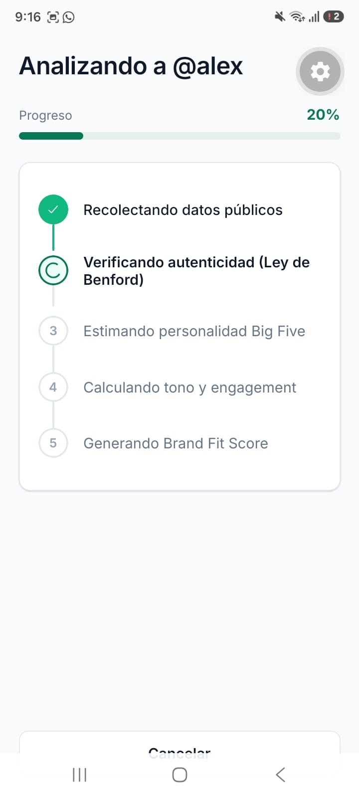

# BrandFit · Prototipo Móvil

<p align="center">
  <strong>Prototipo interactivo de interfaz móvil para la evaluación, auditoría de autenticidad y colaboración estratégica entre marcas y creadores de contenido.</strong>
</p>

<p align="center">
  <a href="https://expo.dev"></a>
  <a href="https://reactnative.dev"></a>
  <a href="https://www.typescriptlang.org"></a>
  <a href="https://deepmind.google/technologies/gemini/"></a>
  <a href="LICENSE"></a>
</p>

---

## Alcance del Repositorio

> [!NOTE]
> Este repositorio corresponde exclusivamente al **prototipo frontend de la aplicación móvil**.
> 
> La aplicación fue construida traduciendo el diseño de **Figma a código ejecutable en React Native con Expo y Expo Go**, apoyándose en herramientas de inteligencia artificial. El sistema está estructurado mediante un **patrón de Arquitectura en Capas (Layered / Clean Architecture)** y modelado con la **metodología Domain-Driven Design (DDD)**. La interfaz utiliza **datos simulados (mock data)** tipados para representar visualmente la navegación, pantallas, reglas de negocio e interacción del flujo de usuario, sin incluir aún la implementación del scraper en tiempo real o los microservicios de backend.

---

## 1. Presentación y Planteamiento del Problema

### ¿Qué se busca resolver?
El marketing de influencers se ha consolidado como un canal publicitario indispensable a nivel global, movilizando miles de millones de dólares anualmente. Sin embargo, adolece de un **problema crítico de ineficiencia, opacidad y riesgo financiero**:
1. **Manipulación de métricas superficiales:** La gran mayoría de marcas toman decisiones basadas únicamente en métricas de vanidad (número bruto de seguidores y likes) que resultan extremadamente vulnerables a la alteración mediante granjas de bots, engagement ficticio y compra masiva de interacciones.
2. **Riesgo de incompatibilidad reputacional:** Existe una alta probabilidad de desalineación entre los valores intrínsecos del creador y el arquetipo corporativo de la marca, lo que genera crisis de relaciones públicas o campañas con nulo retorno sobre la inversión (ROI).
3. **Desperdicio de inversión creativa:** Las marcas desconocen qué formatos de contenido específicos despiertan el interés orgánico real de la audiencia del creador, pautando formatos estáticos que no convierten.

**BrandFit** nace en el segmento B2B para transformar la contratación de influencers de una apuesta intuitiva y azarosa a una **decisión corporativa guiada por datos analíticos y rigor matemático**.

### ¿De dónde se obtiene la información?
La información analizada por el sistema proviene de la huella digital y métricas públicas de los creadores en redes sociales (enfocado primariamente en TikTok):
* **Identidad y metadatos del perfil:** `@username`, nombre visible, avatar, total de seguidores reportados y biografía.
* **Muestra de publicaciones recientes:** Extracción y auditoría de los últimos 10 videos publicados por el creador.
* **Métricas de interacción:** Vistas reproducidas, likes, comentarios, guardados y tasa calculada de engagement orgánico.
* **Distribución de primeros dígitos:** Frecuencia de aparición de dígitos iniciales en contadores de interacciones para análisis forense digital.
* **Análisis de contenido:** Extracción de tonalidad editorial (sentimiento positivo, neutro o negativo) y categorización de formatos de video.

En esta fase del prototipo móvil, estos datos son provistos por repositorios tipados en memoria (`src/infrastructure/repositories/creatorRepository.ts`) diseñados bajo el mismo contrato de interfaz que consumirá el scraper y pipeline de backend definitivo.

---

### Adaptación de Interfaces a Relaciones de Aspecto (9:16, 16:9 y 1:1)

La experiencia de usuario de BrandFit fue diseñada y adaptada meticulosamente considerando los desafíos de fragmentación de dispositivos, tamaño de pantalla, resolución física y densidad de píxeles (DPI/PPI):

```
┌─────────────────┐       ┌───────────────────────────┐       ┌─────────────┐
│                 │       │                           │       │             │
│                 │       │   Gráficos Comparativos   │       │   Avatar /  │
│    Viewport     │       │     y Ley de Benford      │       │ Velocímetro │
│     Móvil       │       │          (16:9)           │       │  SVG (1:1)  │
│     (9:16)      │       │                           │       │             │
│                 │       └───────────────────────────┘       └─────────────┘
│                 │
└─────────────────┘
```

1. **Relación de Aspecto 9:16 (Viewport Vertical Móvil):**
   * **Propósito:** Es la relación estándar de los teléfonos inteligentes modernos y el formato nativo del contenido en TikTok y Reels.
   * **Implementación:** Toda la arquitectura de navegación (`AppNavigator.tsx`) y las pantallas principales (`HomeScreen`, `ProgressScreen`, `BenfordScreen`, `ScoreScreen`, `BigFiveScreen`, `RecsScreen`) se adaptan verticalmente utilizando `SafeAreaView` con detección dinámica de márgenes (`react-native-safe-area-context`) para salvaguardar la visibilidad frente al *notch*, esquinas redondeadas y la *Dynamic Island*.
   * **Scroll elástico y teclado:** En pantallas de menor altura física o alta escala tipográfica, se implementan `<ScrollView>` controlados y `<KeyboardAvoidingView>` para evitar desbordes o superposición con el teclado virtual.
   * **Tarjetas verticales de video:** En `RecsScreen`, las miniaturas de video reproducen la proporción vertical estilizada de un video móvil con badges de ranking superpuestos.

2. **Relación de Aspecto 16:9 (Panorámico / Visualización de Datos y Métricas):**
   * **Propósito:** Desplegar comparativas complejas que requieren amplitud horizontal para evitar saturación perceptiva.
   * **Implementación:** Utilizada en el gráfico de distribución de la **Ley de Benford** (`BenfordScreen`), donde el contraste entre las 9 barras de dígitos observados vs. la curva esperada exige un ancho apaisado proporcional. También se aplica en las tarjetas de estadísticas agregadas (vistas promedio, desglose de sentimiento) para distribuir métricas en columnas balanceadas.

3. **Relación de Aspecto 1:1 (Cuadrangular / Avatares, Insignias y Velocímetro Circular):**
   * **Propósito:** Representación modular simétrica, isotropía visual y elementos identitarios.
   * **Implementación:**
     * **Avatares de creadores (`Avatar.tsx`):** Componente con relación 1:1 estricta, bordes circulares simétricos (`borderRadius: 9999`) y gradientes angulares calculados algorítmicamente mediante `expo-linear-gradient`.
     * **Anillo del Brand Fit Score (`ScoreScreen.tsx`):** Medidor radial de afinidad (0 a 100) implementado vectorialmente con `react-native-svg` (`viewBox="0 0 200 200"`). Al operar con ecuaciones de circunferencia ($C = 2\pi R$) sobre coordenadas normalizadas, mantiene perfecta nitidez matemática y fidelidad geométrica sin pixelación en cualquier densidad de pantalla (desde mdpi hasta xxxhdpi o pantallas Retina).

4. **Densidad de Píxeles y Escala:**
   * La aplicación utiliza unidades abstractas independientes de la densidad (**dp / pt**) nativas de React Native, combinadas con una escala de espaciado y tipografía centralizada (`src/theme/spacing.ts`, `src/theme/typography.ts`), asegurando que botones, campos de texto y márgenes mantengan un tamaño físico ergonómico en dedos humanos (touch targets con `hitSlop`), independientemente de si el dispositivo tiene 320 DPI o 480+ DPI.

---

## 2. Asignación Clara de Tareas y Roles del Grupo

El desarrollo de BrandFit se orquestó dividiendo el flujo integral de negocio en tres fases consecutivas, respaldadas por una fase transversal de liderazgo, integración y arquitectura:

```
┌─────────────────────────────────────────────────────────────────────────────────────────────┐
│                               FLUJO INTEGRAL DEL SISTEMA                                   │
│                                                                                             │
│  [ Fase 1: Entrada y Benford ] ──▶ [ Fase 2: Psicometría y Fit ] ──▶ [ Fase 3: Formatos ]   │
│       Alejandro Chiliquinga              Lizbeth Pillajo                  Alex Tituaña      │
│  ─────────────────────────────────────────────────────────────────────────────────────────  │
│              [ Gestión, Integración de Ramas, Merge PRs y Documentación ]                  │
│                                 Jessiel Chasiguano (PM)                                     │
└─────────────────────────────────────────────────────────────────────────────────────────────┘
```

### Detalle de Integrantes y Contribuciones por Commits

#### 1. Kleber Alejandro Chiliquinga (Alejo) · *Auditoría de Autenticidad y Detección de Fraude*
* **Rama:** `feat/alejo-ux-screens`
* **Concepción de la Idea:**
  > *"Se empezaría ingresando el usuario; el sistema scrapea y pasa las métricas de seguidores y likes por la Ley de Benford. Si la cuenta es sospechosa se lanza una alerta en rojo, y si es auténtica, pasa a la siguiente fase."*
* **Aporte Técnico en el Repositorio:**
  * Implementación y validación de entrada en [HomeScreen.tsx](file:///home/jessiel/Documentos/Móviles/BrandFit/src/screens/HomeScreen.tsx), habilitando envío por teclado (`keyboardType="default"`, `onSubmitEditing`) y desactivando autocorrecciones intrusivas.
  * Ampliación de palabras clave de detección de cuentas fraudulentas (`SUSPICIOUS_HINTS`: `'viralboost'`, `'bot'`, `'fake'`, `'compra'`, `'spam'`).
  * Integración visual de [BenfordScreen.tsx](file:///home/jessiel/Documentos/Móviles/BrandFit/src/screens/BenfordScreen.tsx) con la comparativa matemática de primeros dígitos y alertas condicionales de autenticidad.
  * Creación y ampliación del catálogo de creadores de prueba en la capa de datos.

#### 2. Lizbeth Pillajo (Liz) · *Arquitectura en Capas, Modelado DDD y Brand Fit Score*
* **Rama:** `feat/prototipo-liz`
* **Concepción de la Idea:**
  > *"Sobre los últimos 10 videos se evalúa el engagement real, calculamos la personalidad del creador mediante el modelo Big Five (OCEAN) y el arquetipo de la marca corporativa, y vemos cómo va el fit porcentual entre ambos."*
* **Aporte Técnico en el Repositorio:**
  * Estructuración del patrón de **Arquitectura en Capas (Layered / Clean Architecture)** y aplicación de la metodología **Domain-Driven Design (DDD)**, aislando `src/domain/`, `src/infrastructure/` y `src/context/`.
  * Codificación de las **Reglas de Negocio puras RN-01 a RN-06** en [src/domain/services/rules.ts](file:///home/jessiel/Documentos/Móviles/BrandFit/src/domain/services/rules.ts) (sin acoplamiento a React Native).
  * Construcción de la lógica de evaluación en [ScoreScreen.tsx](file:///home/jessiel/Documentos/Móviles/BrandFit/src/screens/ScoreScreen.tsx) (semáforo de Brand Fit Score, bono de tracción por engagement y veredicto textual RN-03b).
  * Implementación de [BigFiveScreen.tsx](file:///home/jessiel/Documentos/Móviles/BrandFit/src/screens/BigFiveScreen.tsx) para medir la brecha psicométrica (OCEAN) del creador frente al vector ideal del arquetipo, destacando desviaciones críticas con barras ámbar mediante RN-05.
  * Elaboración del documento de arquitectura y metodología [ARCHITECTURE.md](file:///home/jessiel/Documentos/Móviles/BrandFit/ARCHITECTURE.md).

#### 3. Alex Tituaña (Alex) · *Sistema de Diseño Atomic UI y Recomendación de Formatos*
* **Rama:** `feat/alex-ui-components`
* **Concepción de la Idea:**
  > *"Se analizan los videos del creador, el sistema aísla los de mayor acogida de la audiencia y le indica a la marca: 'este influencer tiene fit contigo y te conviene que genere contenido en este formato específico porque la audiencia real lo consume más'."*
* **Aporte Técnico en el Repositorio:**
  * Creación, modularización y estandarización de la librería de componentes atómicos reutilizables en `src/components/` ([Card.tsx](file:///home/jessiel/Documentos/Móviles/BrandFit/src/components/Card.tsx), [Button.tsx](file:///home/jessiel/Documentos/Móviles/BrandFit/src/components/Button.tsx), [Avatar.tsx](file:///home/jessiel/Documentos/Móviles/BrandFit/src/components/Avatar.tsx), [Chip.tsx](file:///home/jessiel/Documentos/Móviles/BrandFit/src/components/Chip.tsx), [TabBar.tsx](file:///home/jessiel/Documentos/Móviles/BrandFit/src/components/TabBar.tsx), [ScreenHeader.tsx](file:///home/jessiel/Documentos/Móviles/BrandFit/src/components/ScreenHeader.tsx), [EmptyState.tsx](file:///home/jessiel/Documentos/Móviles/BrandFit/src/components/EmptyState.tsx)).
  * Unificación multiplataforma de sombras (`elevation` en Android y `shadowOffset`/`shadowOpacity` en iOS) y radios de borde.
  * Incorporación de accesibilidad táctil (`hitSlop` ampliado, roles de accesibilidad para lectores de pantalla).
  * Desarrollo visual de [RecsScreen.tsx](file:///home/jessiel/Documentos/Móviles/BrandFit/src/screens/RecsScreen.tsx) para el ranking de los 3 videos de mayor impacto y la tarjeta del formato editorial sugerido.

#### 4. Jessiel Josue Chasiguano Santin (Jessiel) · *Project Manager, Integración y Arquitectura General*
* **Rol:** Coordinador General y Merge Manager
* **Aporte Técnico en el Repositorio:**
  * Dirección técnica del proyecto, alineación de las ideas del equipo y definición del recorrido de usuario.
  * Gestión centralizada del repositorio GitHub, resolución de conflictos entre ramas y fusión exitosa de todos los Pull Requests (**PR #1 al PR #8**).
  * Refactorización y estabilización de dependencias, tipados y rutas tras la migración a la estructura en capas desacoplada.
  * Elaboración y estructuración de la documentación técnica ([Guia_Maestra_BrandFit.pdf](file:///home/jessiel/Documentos/Móviles/BrandFit/Guia_Maestra_BrandFit.pdf) y [README.md](file:///home/jessiel/Documentos/Móviles/BrandFit/README.md)).
  * Pruebas de integración en vivo sobre emuladores y dispositivos móviles reales mediante **Expo Go**.

### Resumen de Commits y Responsabilidades del Equipo

| Integrante | Rol Principal | Rama de Trabajo | Responsabilidades Clave |
| :--- | :--- | :--- | :--- |
| **Jessiel Chasiguano** | *Project Manager & Integrador* | `main` | Gestión de PRs (#1 a #8), resolución de conflictos, integración global, documentación técnica y aseguramiento de calidad. |
| **Alejandro Chiliquinga** | *UX & Detección de Fraude* | `feat/alejo-ux-screens` | Entrada de datos, scraping conceptual, Ley de Benford, detección de anomalías y teclado en Home. |
| **Lizbeth Pillajo** | *Arquitectura & Modelado DDD* | `feat/prototipo-liz` | Arquitectura en capas, reglas puras RN-01 a RN-06, modelo Big Five, Brand Fit Score y `ARCHITECTURE.md`. |
| **Alex Tituaña** | *Diseño UI & Recomendaciones* | `feat/alex-ui-components` | Atomic Design, biblioteca de componentes nativos, accesibilidad, ranking de videos y recomendaciones en Recs. |

---

## 3. Arquitectura de Software y Metodología de Diseño

Para estructurar la solución de forma profesional, se delimita claramente el **patrón arquitectónico** de la **metodología de diseño**:

### Patrón Arquitectónico: Arquitectura en Capas (Layered Architecture) / Arquitectura Limpia

La arquitectura técnica implementada es una **Arquitectura en Capas con Inversión de Dependencias (inspirada en Clean / Hexagonal Architecture)**:

```
┌────────────────────────────────────────────────────────────────────────┐
│                        CAPAS DE LA APLICACIÓN                          │
├────────────────────────────────────────────────────────────────────────┤
│  📱 PRESENTACIÓN (src/screens, src/components, src/navigation)         │
│     Interfaces nativas de usuario organizadas por Bounded Contexts.   │
├────────────────────────────────────────────────────────────────────────┤
│  ⚙️ APLICACIÓN (src/context - AppContext.tsx)                          │
│     Orquestación de casos de uso, máquina de estados y navegación.    │
├────────────────────────────────────────────────────────────────────────┤
│  🗄️ INFRAESTRUCTURA (src/infrastructure)                               │
│     Adaptadores y repositorios en memoria (creatorRepository.ts).     │
├────────────────────────────────────────────────────────────────────────┤
│  🧠 DOMINIO (src/domain - TypeScript Puro)                            │
│     Modelos, Aggregate Root (Creator), Invariantes y Reglas RN-01..06. │
└────────────────────────────────────────────────────────────────────────┘
```

* **Independencia del Dominio (Regla de Inversión de Dependencias):** El núcleo de la lógica empresarial (`src/domain/`) es 100% TypeScript puro, sin importar React Native ni bibliotecas externas. El dominio define la verdad matemática y psicológica.
* **Capa de Infraestructura como Adaptador:** `src/infrastructure/repositories/creatorRepository.ts` implementa la recuperación de creadores en memoria (`resolveAuditedCreator`), aislando el origen de datos para que en el futuro se conecte a una API real o scraper sin alterar las pantallas ni las reglas.
* **Capa de Aplicación como Orquestador:** `src/context/AppContext.tsx` actúa como caso de uso orquestando el ciclo de vida del análisis (`startAnalysis`, `finishAnalysis`, `setArchetype`).
* **Capa de Presentación Desacoplada:** Pantallas y componentes atómicos consumen servicios de dominio y estado de aplicación sin contener lógica de negocio dura.

---

### Metodología de Diseño: Domain-Driven Design (DDD)

**DDD no es una arquitectura, sino un enfoque metodológico de diseño de software** centrado en el dominio del negocio. En BrandFit se aplica en dos niveles:

1. **Diseño Estratégico (Bounded Contexts):** Delimitación clara de los subdominios funcionales del sistema.
2. **Diseño Táctico:** Implementación de conceptos como *Aggregate Root* (`Creator`), *Value Objects* (`Video`, `Archetype`, `Tone`), *Invariantes* y *Domain Services* (Reglas puras RN-01 a RN-06).

#### Bounded Contexts (Contextos Delimitados)

```
┌─────────────────────────────────────────────────────────────────────────────────────────┐
│                                   BOUNDED CONTEXTS                                      │
├────────────────────────────┬─────────────────────────────┬──────────────────────────────┤
│ **BC1: Auditoría y Fraude**│ **BC2: Afinidad y Fit**     │ **BC3: Recomendaciones**     │
│ (`HomeScreen`, `Progress`, │ (`ScoreScreen`, `BigFive`)  │ (`RecsScreen`)               │
│  `BenfordScreen`)          │                             │                              │
│                            │                             │                              │
│ • Validación de @username  │ • Cálculo Brand Fit (0-100) │ • Top 3 videos por engagement│
│ • Pipeline de auditoría    │ • Bono de engagement        │ • Tono editorial             │
│ • Ley de Benford           │ • Brecha Big Five (OCEAN)   │ • Formato sugerido           │
│ • Veredicto autenticidad   │ • Arquetipos corporativos   │ • Guardián RN-06 (bloqueo)   │
└────────────────────────────┴─────────────────────────────┴──────────────────────────────┘
```

---

### Lenguaje Ubicuo del Dominio (Ubiquitous Language)

Términos compartidos estrictamente entre la visión de negocio, la documentación y el código fuente:

| Término de Negocio | Representación en Código | Definición y Propósito en el Dominio |
| :--- | :--- | :--- |
| **Creador Auditado** | `Creator` *(Aggregate Root)* | Entidad principal que encapsula la identidad, métricas, rasgos psicológicos y evaluaciones de un influencer. |
| **Arquetipo de Marca** | `Archetype` / `ArchetypeId` | Perfil de identidad corporativa (`tech`, `bienestar`, `entretenimiento`, `finanzas`, `causas`). |
| **Distribución de Benford** | `BENFORD_EXPECTED` / `benfordObserved` | Frecuencia teórica esperada ($P(d) = \log_{10}(1 + 1/d)$) contrastada con la distribución real observada de primeros dígitos. |
| **Veredicto de Autenticidad** | `authentic: boolean`, `confidence: number` | Determinación binaria sobre la legitimidad de la cuenta y su porcentaje de certidumbre estadística. |
| **Brand Fit Score** | `scores: Record<ArchetypeId, number>` | Puntuación normalizada de 0 a 100 que cuantifica la compatibilidad estratégica entre el creador y la marca. |
| **Perfil Psicométrico Big Five** | `TRAITS` / `bigFive: number[]` | Vector de cinco dimensiones de la personalidad humana según el modelo OCEAN (Apertura, Responsabilidad, Extraversión, Amabilidad, Neuroticismo). |
| **Vector Ideal del Arquetipo** | `IDEALS: Record<ArchetypeId, number[]>` | Puntuaciones psicométricas de referencia que definen la personalidad idónea para cada arquetipo corporativo. |
| **Brecha Psicométrica** | `evaluateTraitAlignment()` | Discrepancia absoluta ($|Ideal - Creador|$) en cada rasgo de personalidad; activa alerta ámbar si supera la tolerancia. |
| **Bono de Tracción** | `engagementBonus()` | Puntos porcentuales adicionales otorgados al creador con base en su tasa orgánica de interacción. |
| **Tono Editorial** | `Tone` (`'positivo'`, `'neutro'`, `'negativo'`) | Clasificación afectiva predominante del contenido del creador en sus videos recientes. |
| **Muestra de Video Destacado** | `Video` (`topVideos: Video[]`) | Value Object que registra título, vistas formateadas, engagement rate y tono de un video destacado. |
| **Formato Sugerido** | `format: string` | Recomendación táctica directa orientada a maximizar el impacto de la colaboración con la marca. |

---

### Reglas de Negocio Formales (Domain Services — `src/domain/services/rules.ts`)

Todas las decisiones lógicas y matemáticas se encuentran aisladas en servicios puros de dominio:

| Regla | Función en Código | Entrada | Comportamiento y Umbrales |
| :--- | :--- | :--- | :--- |
| **RN-01** | `validateCreatorUsername(rawInput)` | `string` | Sanitiza espacios y prefijo `@`. Exige de 2 a 24 caracteres alfanuméricos, puntos o guiones bajos (`/^[a-zA-Z0-9._]{2,24}$/`). |
| **RN-02** | `hasSuspiciousPattern(username)` | `string` | Evalúa si el identificador coincide con patrones conocidos de cuentas bot o granjas infladas (`SUSPICIOUS_HINTS`). |
| **RN-03a**| `scoreTone(score)` | `number` | Determina el semáforo visual del Brand Fit Score:<br>• $\ge 65 \to$ `'success'` (verde)<br>• $\ge 45 \to$ `'warning'` (ámbar)<br>• $< 45 \to$ `'danger'` (rojo). |
| **RN-03b**| `affinityVerdictLabel(score)` | `number` | Emite la etiqueta textual de afinidad:<br>• $\ge 70 \to$ `"Excelente afinidad"`<br>• $< 70 \to$ `"Buena afinidad"`. |
| **RN-04** | `engagementBonus(engagement)` | `number` | Pondera puntos extra al score según la tasa de interacción:<br>• $\ge 7\% \to +5\text{ pts}$<br>• $\ge 5\% \to +3\text{ pts}$<br>• $\ge 3\% \to +1\text{ pt}$<br>• $< 3\% \to 0\text{ pts}$. |
| **RN-05** | `evaluateTraitAlignment(val, target)` | `val, target` | Evalúa la distancia absoluta ($|target - val|$). Si la diferencia es $\le 15$ puntos, el rasgo está **alineado** (verde); si es $> 15$, marca desalineación (barra ámbar). |
| **RN-06** | `canShowRecommendations(authentic)` | `boolean` | **Guardián de Recomendaciones:** Si `authentic === false`, bloquea las recomendaciones de contenido para impedir invertir en audiencias falsas. |

---

## 4. Enlaces del Diseño (Figma)

El prototipo móvil y su sistema de diseño visual fueron desarrollados en Figma y FigJam:

| Recurso | Herramienta | Enlace |
| :--- | :--- | :--- |
| **Prototipo de Interfaz Móvil** | Figma Design | [](https://www.figma.com/design/QDYvI7DBZFhUtxmk8o9UB5/Prototipo-BradFit-Grupal?node-id=1-3&t=9IAFZa4ba9yWmyDh-1) |
| **Sistema de Atomic Design** | FigJam | [](https://www.figma.com/board/Zk2FYhOvrQX7BCrwJppllL/BrandFit-%C2%B7-Atomic-Design?node-id=0-1&p=f&t=rE8uW77jN4BucfBq-0) |

---

## 5. Concepción de la Idea y Recorrido de Usuario

### Modelo de Negocio e Integración de Perspectivas
Durante las sesiones iniciales de ideación, el equipo debatió entre dos enfoques:
* **Enfoque B2B:** Orientado hacia las marcas que buscan auditar y seleccionar creadores confiables.
* **Enfoque B2C:** Orientado hacia los creadores para analizar su rendimiento y alcance.

Con el soporte analítico de **Gemini 3.8**, ambas perspectivas se unificaron dentro de un único flujo interactivo B2B que acompaña al analista de marketing en una auditoría guiada de principio a fin:

```
[1. Búsqueda] ──▶ [2. Pipeline] ──▶ [3. Benford / Fraude] ──▶ [4. Score & Arquetipos] ──▶ [5. Big Five] ──▶ [6. Recs]
  HomeScreen       ProgressScreen      BenfordScreen             ScoreScreen             BigFiveScreen     RecsScreen
```

1. **Inicio y Búsqueda (`HomeScreen`):** El usuario ingresa el identificador de TikTok del creador. Se ejecuta la regla **RN-01** para validar el formato. Si contiene palabras de alerta (**RN-02**), activa el camino de auditoría fraudulenta.
2. **Pipeline de Carga Animada (`ProgressScreen`):** Simula el proceso de ingesta en 5 fases secuenciales (1.1 segundos cada una):
   * *Paso 1:* Recolección de datos públicos del perfil.
   * *Paso 2:* Verificación estadística de autenticidad (Ley de Benford).
   * *Paso 3:* Estimación de rasgos de personalidad (Big Five).
   * *Paso 4:* Cálculo de distribución de tono y tasa de engagement.
   * *Paso 5:* Generación del Brand Fit Score normalizado.
3. **Auditoría de Autenticidad (`BenfordScreen`):** Exhibe si la cuenta es auténtica o sospechosa. En cuentas genuinas muestra la curva logarítmica de Benford esperada frente a la observada; en cuentas fraudulentas despliega alertas rojas de datos manipulados.
4. **Brand Fit Score y Selector de Arquetipos (`ScoreScreen`):** Presenta el velocímetro circular con el puntaje de afinidad para el arquetipo activo. Permite alternar entre arquetipos corporativos (Tech, Bienestar, Finanzas, etc.) recalculando el puntaje al instante.
5. **Desglose de Personalidad (`BigFiveScreen`):** Compara los 5 rasgos de personalidad del creador contra el ideal del arquetipo. Si la brecha supera el umbral de tolerancia (**RN-05**), resalta la barra en color ámbar.
6. **Recomendaciones Estratégicas (`RecsScreen`):** Presenta los 3 videos con mejor tracción orgánica y sugiere el formato ideal de campaña. Si la cuenta fue catalogada como sospechosa, la regla **RN-06** bloquea esta pantalla protegiendo el presupuesto de la marca.

---

## 6. Demostración Visual del Prototipo

Capturas reales del flujo de navegación y pantallas interactivas ejecutadas en **Expo Go**:

| 1. Inicio y Búsqueda | 2. Progreso de Análisis | 3. Autenticidad (Benford) | 4. Alerta de Anomalías |
| :---: | :---: | :---: | :---: |
|  |  |  |  |

| 5. Brand Fit Score | 6. Selector de Arquetipos | 7. Desglose Big Five | 8. Recomendaciones |
| :---: | :---: | :---: | :---: |
|  |  |  |  |

---

## 7. Uso de Inteligencia Artificial en el Desarrollo

Para el desarrollo integral de este prototipo se utilizó **Gemini 3.8** y el entorno de desarrollo **Antigravity IDE**:

* **Unificación estratégica del modelo de negocio:** Asistencia de Gemini para evaluar las alternativas B2B y B2C planteadas por los integrantes, consolidándolas en un pipeline analítico de tres fases coherente.
* **Traducción de diseño Figma a React Native:** Aceleración en la transformación de los componentes gráficos y tokens de FigJam a componentes nativos en TypeScript, preservando tipografía Inter, gradientes y espaciados originales.
* **Modelado DDD y Arquitectura en Capas:** Asistencia en la estructuración de la arquitectura en capas limpia, desacople del dominio puro y especificación matemática de las reglas RN-01 a RN-06.
* **Configuración del entorno móvil con Expo:** Soporte para la configuración sobre **Expo SDK 58**, compatibilidad de dependencias de React 19 y optimización para ejecución fluida en **Expo Go**.

---

## 8. Estructura del Repositorio

El código fuente se encuentra organizado directamente en la raíz del repositorio siguiendo principios de Arquitectura en Capas, Domain-Driven Design y Atomic Design:

```text
BrandFit/
├── assets/                     # Recursos gráficos e iconos de la aplicación
├── docs/                       # Documentación visual, diagramas de diseño y capturas
│   ├── design/                 # Esquemas de arquitectura Atomic Design
│   └── screenshots/            # Capturas reales del prototipo en ejecución
├── src/
│   ├── components/             # Librería de componentes reutilizables (Atomic Design)
│   │   ├── AppText.tsx         # Tipografía tipada con variantes de peso Inter
│   │   ├── Avatar.tsx          # Avatar 1:1 con gradiente dinámico por tonalidad
│   │   ├── Button.tsx          # Botón táctil con retroalimentación y hitSlop
│   │   ├── Card.tsx            # Contenedor modular con sombras multiplataforma
│   │   ├── Chip.tsx            # Chips para categorías, arquetipos y semáforo
│   │   ├── EmptyState.tsx      # Estado visual para pantallas sin creador seleccionado
│   │   ├── ScreenHeader.tsx    # Encabezado estándar con títulos elásticos
│   │   └── TabBar.tsx          # Barra de navegación inferior
│   ├── context/                # Capa de Aplicación: orquestador global (AppContext.tsx)
│   ├── data/                   # Capa de compatibilidad retroactiva (re-exports)
│   ├── domain/                 # 🧠 CAPA DE DOMINIO (TypeScript Puro - 0% UI)
│   │   ├── models/
│   │   │   ├── constants.ts    # Invariantes: ARCHETYPES, TRAITS, IDEALS, BENFORD_EXPECTED
│   │   │   └── types.ts        # Aggregate Root (Creator), Value Objects y tipos de dominio
│   │   ├── services/
│   │   │   └── rules.ts        # Reglas de Negocio puras RN-01 a RN-06
│   │   └── index.ts            # Barrel export del dominio
│   ├── infrastructure/         # 🗄️ CAPA DE INFRAESTRUCTURA
│   │   └── repositories/
│   │       └── creatorRepository.ts # Repositorio de consulta en memoria (resolveAuditedCreator)
│   ├── navigation/             # Enrutador de pantallas y protección de notch (AppNavigator.tsx)
│   ├── screens/                # 📱 CAPA DE PRESENTACIÓN (Vistas por Bounded Context)
│   │   ├── HomeScreen.tsx      # BC1: Inicio, búsqueda de @username y validación RN-01
│   │   ├── ProgressScreen.tsx  # BC1: Pipeline interactivo de auditoría (5 fases)
│   │   ├── BenfordScreen.tsx   # BC1: Auditoría forense con Ley de Benford y alerta de fraude
│   │   ├── ScoreScreen.tsx     # BC2: Brand Fit Score (0-100), velocímetro SVG y arquetipos
│   │   ├── BigFiveScreen.tsx   # BC2: Desglose psicométrico OCEAN y brecha con ideal RN-05
│   │   ├── RecsScreen.tsx      # BC3: Top 3 videos por engagement, formato y guardián RN-06
│   │   └── NoAnalysis.tsx      # Vista fallback cuando no hay creador cargado
│   └── theme/                  # Tokens de diseño: colores, espaciados, sombras y tipografía
├── app.json                    # Configuración del proyecto Expo (SDK 58)
├── babel.config.js             # Configuración del transpilador Babel
├── index.ts                    # Punto de entrada de la aplicación
├── package.json                # Manifiesto de dependencias y scripts
├── tsconfig.json               # Configuración del compilador TypeScript
├── ARCHITECTURE.md             # Especificación técnica de la Arquitectura en Capas y metodología DDD
├── Guia_Maestra_BrandFit.pdf   # Guía maestra completa del proyecto y manual de estudio
└── README.md                   # Documentación general del repositorio
```

---

## 9. Instrucciones de Ejecución

### Requisitos previos

* **Node.js** (versión 18 o superior).
* La aplicación móvil **Expo Go** instalada en tu teléfono ([Google Play Store](https://play.google.com/store/apps/details?id=host.exp.exponent) o [Apple App Store](https://apps.apple.com/app/expo-go/id982107779)), o un emulador móvil configurado (Android Studio / Xcode).

### Pasos para ejecutar

1. **Clonar y acceder a la carpeta del proyecto:**
   ```bash
   git clone https://github.com/JessielCH/BrandFit_Grupo9.git
   cd BrandFit
   ```

2. **Instalar dependencias:**
   ```bash
   npm install --legacy-peer-deps
   ```

3. **Iniciar el servidor de desarrollo de Expo:**
   ```bash
   npx expo start -c
   ```

4. **Visualizar la aplicación:**
   * **En Android:** Abre la app **Expo Go**, pulsa en *Scan QR code* y escanea el código mostrado en tu terminal.
   * **En iOS:** Abre la cámara de tu iPhone, enfoca el código QR y pulsa la notificación que abrirá **Expo Go**.
   * **En Navegador Web:** Presiona la tecla **`w`** en la terminal.

> [!TIP]
> **Para probar la detección de cuentas sospechosas:** Escribe `@viralboost`, `@bot` o `@fake` en el buscador de la pantalla de inicio para experimentar el flujo de alerta de fraude con resultados en rojo y bloqueo de recomendaciones.

---

## 10. Documentación Complementaria

Para profundizar en los detalles técnicos y operativos del proyecto, consulta los siguientes documentos incluidos en este repositorio:

* [ARCHITECTURE.md](file:///home/jessiel/Documentos/Móviles/BrandFit/ARCHITECTURE.md): Detalla los contratos de tipos, Aggregate Roots, Value Objects, invariantes del dominio y matriz de responsabilidades por Bounded Context.
* [Guia_Maestra_BrandFit.pdf](file:///home/jessiel/Documentos/Móviles/BrandFit/Guia_Maestra_BrandFit.pdf): Manual pedagógico que explica cada archivo del proyecto línea por línea, arquitectura React Native vs. Web, flujo de ejecución y guía para demostraciones en vivo.

---

## Licencia

Este proyecto está distribuido bajo la licencia [MIT](LICENSE).
