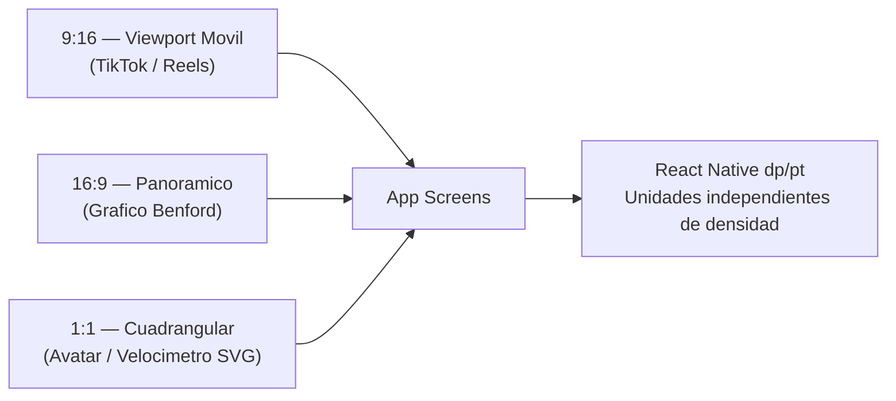
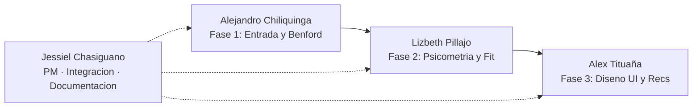
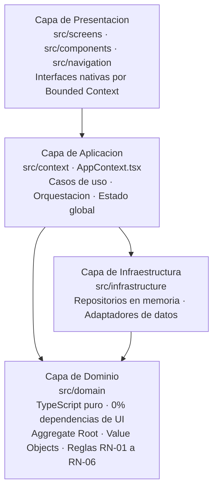
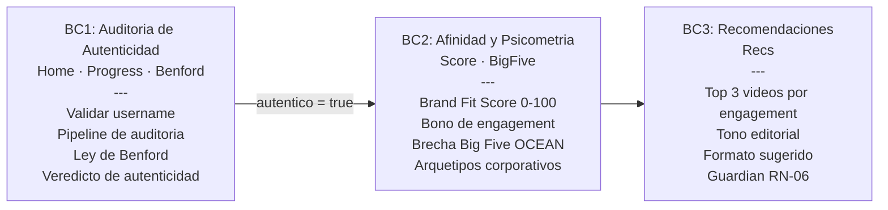
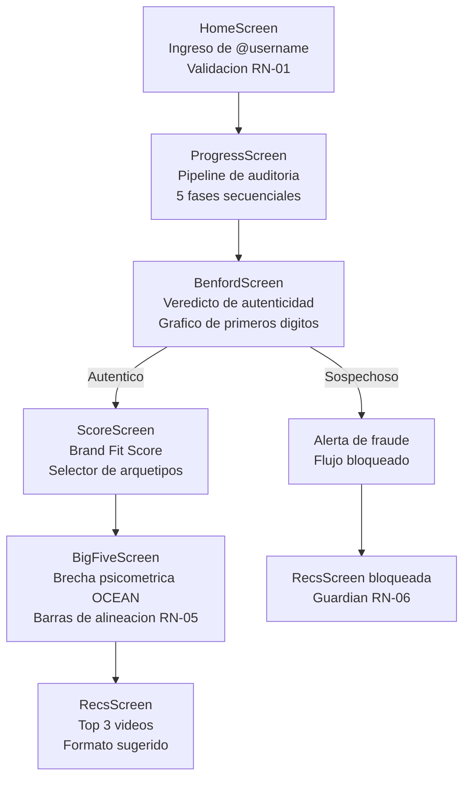
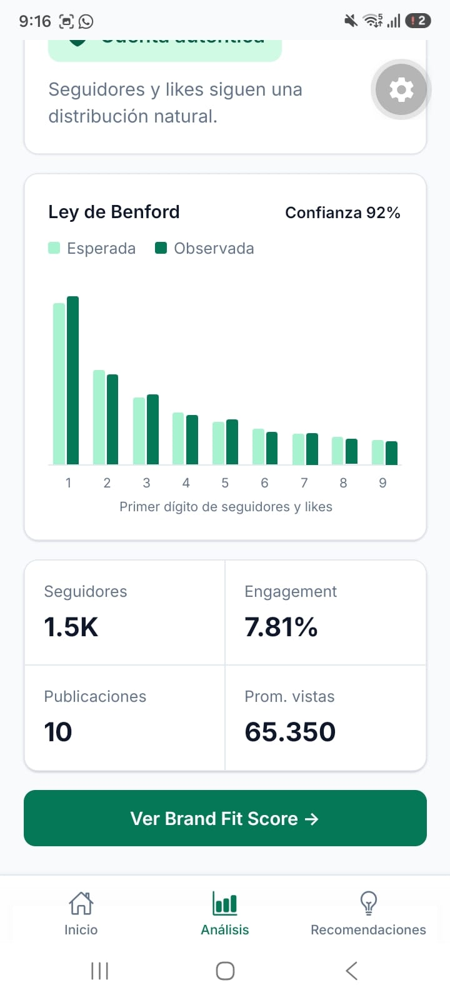
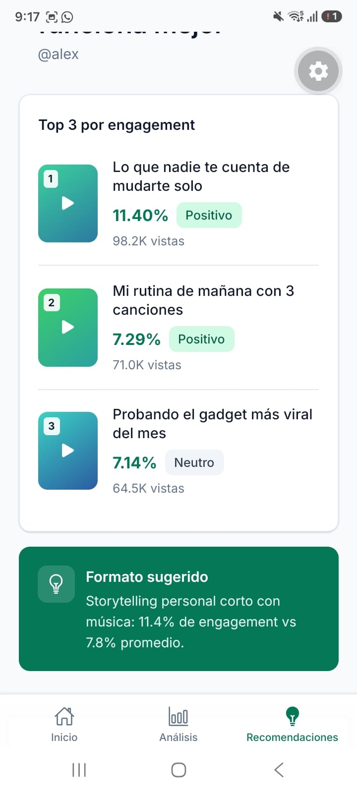

# BrandFit · Prototipo Movil

<p align="center">
  <strong>Prototipo interactivo de interfaz movil para la evaluacion, auditoria de autenticidad y colaboracion estrategica entre marcas y creadores de contenido.</strong>
</p>

<p align="center">
  <a href="https://expo.dev"></a>
  <a href="https://reactnative.dev"></a>
  <a href="https://www.typescriptlang.org"></a>
  <a href="https://deepmind.google/technologies/gemini/"></a>
  <a href="LICENSE"></a>
</p>

---

## Alcance del Repositorio

> [!NOTE]
> Este repositorio corresponde exclusivamente al **prototipo frontend de la aplicacion movil**.
>
> La interfaz fue construida traduciendo el diseno de Figma a codigo ejecutable en React Native con Expo, apoyandose en herramientas de inteligencia artificial. El sistema esta estructurado con un **patron de Arquitectura en Capas (Layered / Clean Architecture)** y modelado bajo la **metodologia Domain-Driven Design (DDD)**. Los datos son simulados (mock data) tipados para representar el flujo completo sin scraper ni backend.

---

## 1. Presentacion y Planteamiento del Problema

### El Problema

El marketing de influencers mueve miles de millones de dolares anuales en el segmento B2B, pero sufre tres fallas criticas:

| # | Problema | Consecuencia |
|---|---|---|
| 1 | **Metricas infladas artificialmente** — seguidores y likes comprados o generados por bots | Inversion en audiencias falsas que no convierten |
| 2 | **Incompatibilidad de valores** — el arquetipo de la marca choca con la personalidad real del creador | Crisis reputacionales y ROI nulo en campanas |
| 3 | **Desconocimiento del formato organico** — las marcas desconocen que tipo de contenido genera traccion real | Presupuesto creativo desperdiciado en formatos que no enganchan |

**BrandFit** transforma la contratacion de influencers de una apuesta intuitiva a una **decision corporativa respaldada por datos y rigor matematico**.

---

### Origen de la Informacion

La informacion analizada proviene de la huella digital publica del creador en TikTok:

| Fuente | Dato Extraido |
|---|---|
| Perfil publico | `@username`, nombre, avatar, total de seguidores |
| Ultimas 10 publicaciones | Vistas, likes, comentarios, guardados |
| Metricas de interaccion | Tasa de engagement organico calculada |
| Primeros digitos de contadores | Distribucion para analisis forense (Ley de Benford) |
| Contenido del video | Tonalidad editorial (positiva, neutra, negativa) y formato |

En esta fase, los datos son provistos por repositorios en memoria (`src/infrastructure/repositories/creatorRepository.ts`) con el mismo contrato de interfaz que consumira el scraper definitivo.

---

### Adaptacion de Interfaces a Relaciones de Aspecto

La experiencia de usuario fue disenada considerando fragmentacion de dispositivos, tamano de pantalla, resolucion y densidad de pixeles (DPI/PPI):



| Aspecto | Uso en la App | Implementacion |
|---|---|---|
| **9:16** (vertical movil) | Todas las pantallas principales | `SafeAreaView` con `react-native-safe-area-context`; `ScrollView` + `KeyboardAvoidingView` para notch y teclado |
| **16:9** (panoramico) | Grafico de Ley de Benford en `BenfordScreen` | 9 barras comparativas con amplitud horizontal para evitar saturacion visual |
| **1:1** (cuadrangular) | Avatares de creadores y velocimetro de Brand Fit Score | `borderRadius: 9999` con gradientes; SVG `viewBox="0 0 200 200"` para perfecta nitidez en cualquier DPI |

---

## 2. Equipo y Asignacion de Tareas

### Flujo de Responsabilidades



### Contribuciones Detalladas

#### Kleber Alejandro Chiliquinga — Auditoria de Autenticidad y Deteccion de Fraude
**Rama:** `feat/alejo-ux-screens`

> *"Se empezaria ingresando el usuario; el sistema scrapea y pasa las metricas de seguidores y likes por la Ley de Benford. Si la cuenta es sospechosa se lanza una alerta en rojo, y si es autentica, pasa a la siguiente fase."*

| Area | Contribucion |
|---|---|
| `HomeScreen.tsx` | Envio por teclado (`onSubmitEditing`), desactivacion de autocorrecciones |
| `src/domain/models/constants.ts` | Ampliacion de `SUSPICIOUS_HINTS` con palabras clave de bots |
| `BenfordScreen.tsx` | Visualizacion comparativa matematica de primeros digitos y alertas de autenticidad |
| Datos de prueba | Creacion y ampliacion del catalogo de creadores en la capa de infraestructura |

---

#### Lizbeth Pillajo — Arquitectura en Capas, Modelado DDD y Brand Fit Score
**Rama:** `feat/prototipo-liz`

> *"Sobre los ultimos 10 videos se evalua el engagement real, calculamos la personalidad del creador mediante el modelo Big Five (OCEAN) y el arquetipo de la marca corporativa, y vemos como va el fit porcentual entre ambos."*

| Area | Contribucion |
|---|---|
| Arquitectura | Estructuracion del patron en capas: `src/domain/`, `src/infrastructure/`, `src/context/` |
| Reglas de negocio | Implementacion de `RN-01` a `RN-06` en `rules.ts` (TypeScript puro, 0% UI) |
| `ScoreScreen.tsx` | Semaforo del Brand Fit Score, bono de traccion (`RN-04`) y veredicto textual (`RN-03b`) |
| `BigFiveScreen.tsx` | Brecha psicometrica OCEAN frente al ideal del arquetipo con barras ambar (`RN-05`) |
| `ARCHITECTURE.md` | Documento de arquitectura y metodologia |

---

#### Alex Tiuaña — Sistema de Diseno UI y Recomendacion de Formatos
**Rama:** `feat/alex-ui-components`

> *"Se analizan los videos del creador, el sistema aisla los de mayor acogida y le indica a la marca que formato especifico de contenido genera mas consumo organico en su audiencia real."*

| Area | Contribucion |
|---|---|
| Libreria de componentes | Creacion de `Card`, `Button`, `Avatar`, `Chip`, `TabBar`, `ScreenHeader`, `EmptyState` |
| Accesibilidad | `hitSlop` ampliado, `accessibilityRole`, sombras multiplataforma (`elevation` / `shadowOffset`) |
| `RecsScreen.tsx` | Ranking de top 3 videos por engagement y tarjeta de formato editorial sugerido |

---

#### Jessiel Josue Chasiguano Santin — Project Manager, Integracion y Documentacion
**Rol:** Coordinador General y Merge Manager

| Area | Contribucion |
|---|---|
| Gestion del repositorio | Apertura y fusion exitosa de Pull Requests #1 al #8, resolucion de conflictos entre ramas |
| Estabilizacion tecnica | Refactorizacion de dependencias, tipados y rutas tras la migracion a la estructura en capas |
| Documentacion | Redaccion de `README.md`, `ARCHITECTURE.md` y guias del proyecto |
| Validacion | Pruebas de integracion en dispositivos reales mediante Expo Go |

### Resumen del Equipo

| Integrante | Rol | Rama | Responsabilidad Principal |
|---|---|---|---|
| **Jessiel Chasiguano** | Project Manager | `main` | Gestion de PRs, integracion, documentacion, estabilizacion |
| **Alejandro Chiliquinga** | Auditoria y UX | `feat/alejo-ux-screens` | Entrada de datos, Ley de Benford, deteccion de anomalias |
| **Lizbeth Pillajo** | Arquitectura y Dominio | `feat/prototipo-liz` | Arquitectura en capas, modelado DDD, Big Five, Brand Fit Score |
| **Alex Tituaña** | Diseno UI | `feat/alex-ui-components` | Atomic Design, componentes reutilizables, accesibilidad, Recs |

---

## 3. Arquitectura de Software

### Patron Arquitectonico: Arquitectura en Capas (Layered / Clean Architecture)

La arquitectura implementada es un patron de **Capas con Inversion de Dependencias**, donde el flujo de dependencias apunta siempre hacia el nucleo (dominio), que permanece totalmente aislado de React Native y de cualquier libreria externa.



| Capa | Ubicacion | Responsabilidad |
|---|---|---|
| **Presentacion** | `src/screens`, `src/components`, `src/navigation` | Renderizado de interfaces organizadas por Bounded Context |
| **Aplicacion** | `src/context/AppContext.tsx` | Orquestacion de casos de uso: `startAnalysis`, `finishAnalysis`, `setArchetype` |
| **Infraestructura** | `src/infrastructure/repositories/` | Resolucion de entidades auditadas: `resolveAuditedCreator(username)` |
| **Dominio** | `src/domain/` | Modelos, invariantes y reglas de negocio puras; independiente del entorno de ejecucion |

---

### Metodologia de Diseno: Domain-Driven Design (DDD)

DDD no es una arquitectura sino un **enfoque metodologico de modelado de software** centrado en el dominio del negocio. Se aplica en dos niveles:

**Diseno Estrategico — Bounded Contexts**



**Diseno Tactico — Lenguaje Ubicuo**

| Termino de Negocio | Codigo | Definicion |
|---|---|---|
| Creador Auditado | `Creator` *(Aggregate Root)* | Entidad principal: identidad, metricas, rasgos y evaluaciones del influencer |
| Arquetipo de Marca | `Archetype` / `ArchetypeId` | Perfil de identidad corporativa: `tech`, `bienestar`, `entretenimiento`, `finanzas`, `causas` |
| Distribucion de Benford | `BENFORD_EXPECTED` / `benfordObserved` | Frecuencia teorica vs. observada de primeros digitos en contadores |
| Veredicto de Autenticidad | `authentic: boolean`, `confidence: number` | Determinacion binaria de legitimidad de la cuenta |
| Brand Fit Score | `scores: Record<ArchetypeId, number>` | Puntuacion de compatibilidad normalizada 0-100 |
| Perfil Big Five | `TRAITS` / `bigFive: number[]` | Vector OCEAN de la personalidad del creador (Apertura, Responsabilidad, Extraversion, Amabilidad, Neuroticismo) |
| Vector Ideal | `IDEALS: Record<ArchetypeId, number[]>` | Puntuaciones psicometricas de referencia por arquetipo |
| Brecha Psicometrica | `evaluateTraitAlignment()` | Distancia absoluta creador vs. ideal; activa barra ambar si supera tolerancia |
| Bono de Traccion | `engagementBonus()` | Puntos extra segun tasa de engagement organico |
| Tono Editorial | `Tone` | Clasificacion afectiva: `positivo`, `neutro`, `negativo` |
| Video Destacado | `Video` *(Value Object)* | Titulo, vistas, engagement rate y tono de un video de la muestra |
| Formato Sugerido | `format: string` | Recomendacion tactica de formato de contenido para la campana |

---

### Reglas de Negocio — Domain Services

Todas las decisiones logicas y matematicas estan aisladas en `src/domain/services/rules.ts` como funciones TypeScript puras, sin dependencias de UI:

| Regla | Funcion | Comportamiento |
|---|---|---|
| **RN-01** | `validateCreatorUsername(rawInput)` | Sanitiza `@` y espacios. Valida `/^[a-zA-Z0-9._]{2,24}$/` |
| **RN-02** | `hasSuspiciousPattern(username)` | Detecta coincidencias con `SUSPICIOUS_HINTS` (bots, granjas infladas) |
| **RN-03a** | `scoreTone(score)` | `>= 65` → success · `>= 45` → warning · `< 45` → danger |
| **RN-03b** | `affinityVerdictLabel(score)` | `>= 70` → "Excelente afinidad" · `< 70` → "Buena afinidad" |
| **RN-04** | `engagementBonus(engagement)` | `>= 7%` → +5 pts · `>= 5%` → +3 pts · `>= 3%` → +1 pt · `< 3%` → 0 |
| **RN-05** | `evaluateTraitAlignment(val, target)` | `|target - val| <= 15` → alineado (verde) · `> 15` → desalineado (ambar) |
| **RN-06** | `canShowRecommendations(authentic)` | Bloquea `RecsScreen` si `authentic === false` |

---

## 4. Recorrido del Usuario



| Pantalla | Bounded Context | Descripcion |
|---|---|---|
| `HomeScreen` | BC1 | Validacion de `@username` con RN-01; deteccion de patron sospechoso con RN-02 |
| `ProgressScreen` | BC1 | Pipeline animado de 5 fases (1.1 s c/u): recoleccion, Benford, Big Five, engagement, Score |
| `BenfordScreen` | BC1 | Curva logaritmica esperada vs. observada; alerta roja si `authentic === false` |
| `ScoreScreen` | BC2 | Velocimetro SVG 0-100; selector de arquetipos con recalculo instantaneo; RN-03b |
| `BigFiveScreen` | BC2 | Cinco barras OCEAN del creador vs. ideal del arquetipo; barras ambar por RN-05 |
| `RecsScreen` | BC3 | Ranking de top 3 videos por engagement; formato sugerido; bloqueada por RN-06 si fraude |

---

## 5. Diseno Visual (Figma)

| Recurso | Enlace |
|---|---|
| **Prototipo de Interfaz Movil** | [](https://www.figma.com/design/QDYvI7DBZFhUtxmk8o9UB5/Prototipo-BradFit-Grupal?node-id=1-3&t=9IAFZa4ba9yWmyDh-1) |
| **Sistema de Atomic Design** | [](https://www.figma.com/board/Zk2FYhOvrQX7BCrwJppllL/BrandFit-%C2%B7-Atomic-Design?node-id=0-1&p=f&t=rE8uW77jN4BucfBq-0) |

---

## 6. Demostracion Visual

Capturas reales del flujo de navegacion ejecutadas en **Expo Go**:

| 1. Inicio y Busqueda | 2. Progreso de Analisis | 3. Autenticidad (Benford) | 4. Alerta de Anomalias |
| :---: | :---: | :---: | :---: |
|  |  |  |  |

| 5. Brand Fit Score | 6. Selector de Arquetipos | 7. Desglose Big Five | 8. Recomendaciones |
| :---: | :---: | :---: | :---: |
|  |  |  |  |

---

## 7. Uso de Inteligencia Artificial

| Herramienta | Uso en el Proyecto |
|---|---|
| **Gemini 3.8 (Antigravity IDE)** | Unificacion estrategica del modelo de negocio B2B/B2C; traduccion de diseno Figma a React Native; modelado de la arquitectura en capas y reglas DDD; configuracion de Expo SDK 58 y compatibilidad de dependencias |

---

## 8. Estructura del Repositorio

```text
BrandFit/
├── assets/                              Recursos graficos e iconos
├── docs/
│   ├── design/                          Esquemas de Atomic Design
│   └── screenshots/                     Capturas reales del prototipo
├── src/
│   ├── components/                      Libreria de componentes atomicos reutilizables
│   │   ├── AppText.tsx                  Tipografia tipada con variantes Inter
│   │   ├── Avatar.tsx                   Avatar 1:1 con gradiente dinamico
│   │   ├── Button.tsx                   Boton tactil con hitSlop y retroalimentacion
│   │   ├── Card.tsx                     Contenedor con sombras multiplataforma
│   │   ├── Chip.tsx                     Chips para arquetipos y semaforo
│   │   ├── EmptyState.tsx               Estado sin creador cargado
│   │   ├── ScreenHeader.tsx             Encabezado estandar con titulos elasticos
│   │   └── TabBar.tsx                   Barra de navegacion inferior
│   ├── context/                         Capa de Aplicacion — AppContext.tsx
│   ├── data/                            Re-exports de compatibilidad retroactiva
│   ├── domain/                          CAPA DE DOMINIO (TypeScript puro)
│   │   ├── models/constants.ts          Invariantes: ARCHETYPES, TRAITS, IDEALS, BENFORD_EXPECTED
│   │   ├── models/types.ts              Aggregate Root Creator y Value Objects
│   │   └── services/rules.ts           Reglas de negocio puras RN-01 a RN-06
│   ├── infrastructure/                  CAPA DE INFRAESTRUCTURA
│   │   └── repositories/
│   │       └── creatorRepository.ts    resolveAuditedCreator(username)
│   ├── navigation/                      AppNavigator.tsx
│   ├── screens/                         CAPA DE PRESENTACION
│   │   ├── HomeScreen.tsx               BC1: busqueda y validacion RN-01
│   │   ├── ProgressScreen.tsx           BC1: pipeline de auditoria
│   │   ├── BenfordScreen.tsx            BC1: auditoria forense y alerta
│   │   ├── ScoreScreen.tsx              BC2: Brand Fit Score y arquetipos
│   │   ├── BigFiveScreen.tsx            BC2: brecha psicometrica OCEAN
│   │   ├── RecsScreen.tsx               BC3: top 3 videos y formato sugerido
│   │   └── NoAnalysis.tsx               Vista fallback
│   └── theme/                           Tokens de diseno: colores, espaciados, tipografia
├── ARCHITECTURE.md                      Especificacion tecnica de la arquitectura
├── app.json                             Configuracion Expo SDK 58
├── babel.config.js
├── index.ts
├── package.json
├── tsconfig.json
└── README.md
```

---

## 9. Instrucciones de Ejecucion

**Requisitos:** Node.js 18+ y la app [Expo Go](https://expo.dev/go) en tu dispositivo movil.

```bash
# 1. Clonar el repositorio
git clone https://github.com/JessielCH/BrandFit_Grupo9.git
cd BrandFit

# 2. Instalar dependencias
npm install --legacy-peer-deps

# 3. Iniciar el servidor de desarrollo
npx expo start -c
```

| Plataforma | Accion |
|---|---|
| **Android** | Abrir Expo Go y escanear el codigo QR de la terminal |
| **iOS** | Enfocar el QR con la camara nativa y pulsar la notificacion |
| **Web** | Presionar `w` en la terminal |

> [!TIP]
> Para activar el flujo de cuenta sospechosa, escribe `@viralboost`, `@bot` o `@fake` en la pantalla de inicio.

---

## 10. Documentacion Complementaria

| Documento | Descripcion |
|---|---|
| [ARCHITECTURE.md](ARCHITECTURE.md) | Contratos de tipos, Aggregate Roots, invariantes del dominio y responsabilidades por Bounded Context |

---

## Licencia

Distribuido bajo la licencia [MIT](LICENSE).
